# Análise Forense de um Pendrive Suspeito

> **Tipo:** Lab Blue Team — análise forense de dispositivo USB não confiável
> **Ambiente:** notebook com Linux Mint 22.3 Cinnamon
> **Data da análise:** 2026-10-21 (horários em UTC-3)
> **Veredito:** ✅ **LIMPO** — sem ameaça; pendrive genérico já usado e reformatado

> 🔒 **Privacidade dos prints:** os prints foram tratados antes da publicação. Foram ocultados o usuário e o hostname da máquina, o MAC do roteador Wi-Fi e os hashes da allowlist do USBGuard (que permitiriam emular os periféricos autorizados). O texto refletido de outras janelas ao fundo do terminal também foi removido.

---

## Sumário

1. [Resumo executivo](#1-resumo-executivo)
2. [Cenário e modelo de ameaça](#2-cenário-e-modelo-de-ameaça)
3. [Ambiente e ferramentas](#3-ambiente-e-ferramentas)
4. [Fase 1 — Preparação](#4-fase-1--preparação-antes-de-conectar)
5. [Fase 2 — Identificação do dispositivo](#5-fase-2--identificação-do-dispositivo)
6. [Fase 3 — Aquisição forense](#6-fase-3--aquisição-forense)
7. [Fase 4 — Análise do conteúdo](#7-fase-4--análise-do-conteúdo)
8. [Teste de capacidade real](#8-teste-de-capacidade-real)
9. [Conclusão e veredito](#9-conclusão-e-veredito)
10. [Sanitização e restauração](#10-sanitização-e-restauração-do-ambiente)
11. [Lições aprendidas](#11-lições-aprendidas)
12. [Mitigações](#12-mitigações-ambiente-corporativo)
13. [Linha do tempo](#13-linha-do-tempo)
14. [Referências](#14-referências)

---

## 1. Resumo executivo

Um pendrive de origem desconhecida foi tratado como **potencialmente malicioso** e analisado sem comprometer a estação de trabalho.

| Pergunta | Resposta |
|---|---|
| É um BadUSB (teclado disfarçado)? | **Não.** Declara uma única interface `08:06:50` (Mass Storage) |
| Tem malware nos arquivos? | **Não.** O sistema de arquivos está vazio, sem arquivos apagados; 0 detecções do ClamAV em todas as regiões |
| Tem partição ou área oculta? | **Não há partição oculta.** Foram encontrados três resíduos de dados, todos explicados ou classificados como não executáveis |
| A capacidade é real? | **Sim.** `f3probe`: 28,91 GiB utilizáveis = 28,91 GiB anunciados |
| Pode ser reutilizado? | **Sim**, após sanitização (zerar e reformatar) |

**Principal achado:** cerca de 99 MB de **dados residuais de um dono anterior**, deixados por uma formatação rápida. A análise estatística indica dados compactados e fragmentados, não criptografia nem payload executável.

---

## 2. Cenário e modelo de ameaça

Pendrives encontrados, recebidos de terceiros ou de procedência duvidosa são um vetor de ataque clássico (*USB drop attack*). Ameaças consideradas:

| Ameaça | Como funciona | O antivírus detecta? | MITRE ATT&CK |
|---|---|---|---|
| **BadUSB / Rubber Ducky** | O firmware se apresenta como teclado e digita comandos | ❌ Não, porque não há arquivo | [T1200](https://attack.mitre.org/techniques/T1200/) Hardware Additions |
| **Malware em arquivos** | Executáveis, scripts, atalhos `.lnk`, macros | ✅ Geralmente | [T1091](https://attack.mitre.org/techniques/T1091/) / [T1204.002](https://attack.mitre.org/techniques/T1204/002/) |
| **Autorun / CD-ROM virtual** | Partição que emula CD para execução automática | ⚠️ Parcialmente | [T1091](https://attack.mitre.org/techniques/T1091/) |
| **Partição ou área oculta** | Dados fora do sistema de arquivos visível | ❌ Não, sem inspeção manual | — |
| **Capacidade falsa** | Anuncia mais espaço do que tem e corrompe dados | ❌ Não | — |
| **USB Killer** | Descarga elétrica que queima a porta | ❌ Não, é ataque físico | — |

**Premissa de trabalho:** o dispositivo é hostil até prova em contrário.

---

## 3. Ambiente e ferramentas

| Item | Valor |
|---|---|
| Sistema | Linux Mint 22.3 Cinnamon |
| Proteção de dispositivos | USBGuard |
| Antivírus | ClamAV, engine 1.5.4, 3.628.180 assinaturas (daily 28160, main 63, bytecode 339) |
| Forense | `dd`, `sha256sum`, `blockdev`, `fdisk`, `parted`, Sleuth Kit (`fsstat`, `fls`), PhotoRec 7.1, `binwalk`, `xxd`, `strings`, Python 3 |
| Capacidade | f3 8.0 (`f3probe`) |

### 3.1 Imprevisto na preparação

A instalação das ferramentas falhou com `HTTP 530` vindo do espelho `archive.eibly.com`. O endereço `2606:4700:...` é do Cloudflare, e o servidor de origem estava fora do ar.

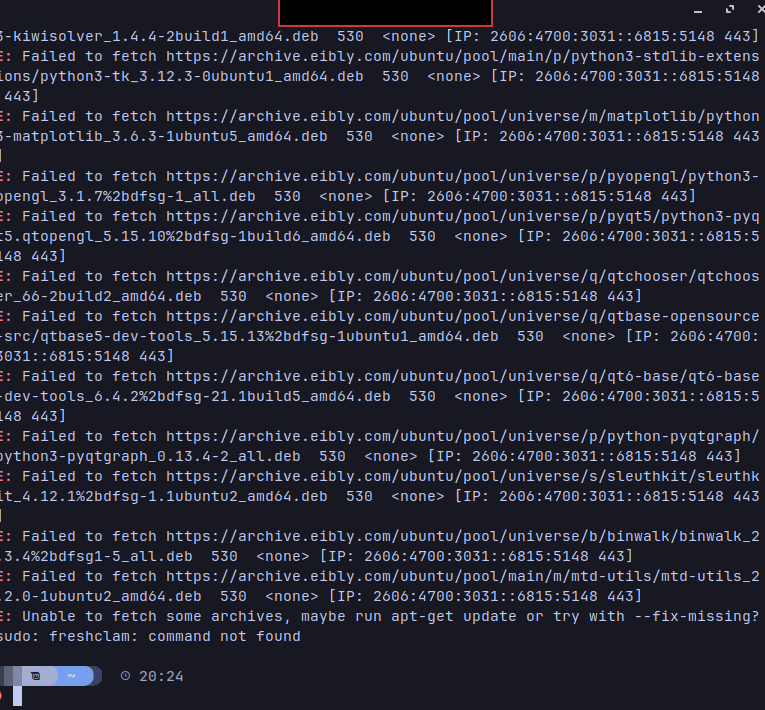

O espelho estava configurado só em `official-package-repositories.list`:

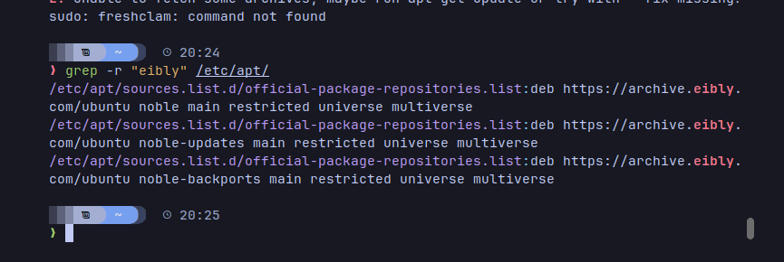

A correção foi trocar o espelho pelo oficial `archive.ubuntu.com`:

```bash
sudo sed -i 's|https://archive.eibly.com/ubuntu|http://archive.ubuntu.com/ubuntu|g' \
  /etc/apt/sources.list.d/official-package-repositories.list
```

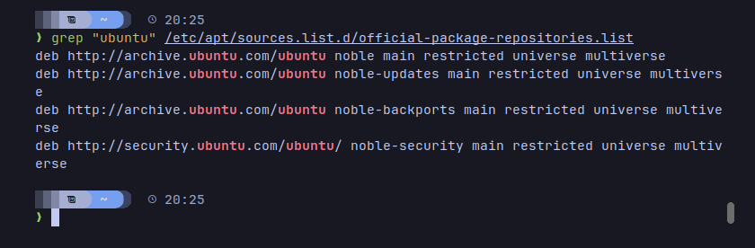

Depois da instalação, o `freshclam` manual falhou com *Failed to lock the log file*. O motivo era que o serviço `clamav-freshclam` já estava atualizando em segundo plano. O log confirma a atualização dos três bancos:

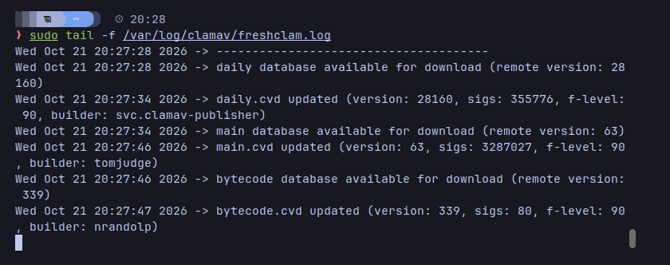

---

## 4. Fase 1 — Preparação (antes de conectar)

### 4.1 USBGuard: bloquear dispositivos novos

```bash
sudo sh -c 'usbguard generate-policy > /etc/usbguard/rules.conf'
sudo systemctl enable --now usbguard
sudo usbguard list-devices
```

A política foi gerada com o hub USB-C e todos os periféricos conectados.

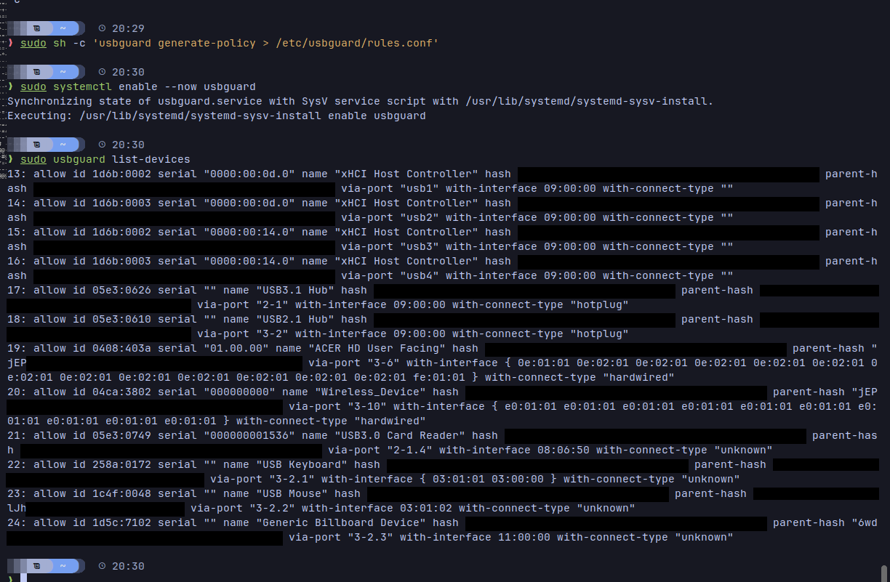

| IDs | Dispositivo | Classe de interface |
|---|---|---|
| 13–16 | xHCI Host Controller (controladoras do notebook) | `09` Hub |
| 17–18 | USB3.1 Hub / USB2.1 Hub (hub USB-C) | `09` Hub |
| 19 | ACER HD User Facing (webcam) | `0e` Video |
| 20 | Wireless_Device (Bluetooth) | `e0` Wireless |
| 21 | USB3.0 Card Reader | **`08` Mass Storage** |
| 22 | USB Keyboard | **`03` HID** |
| 23 | USB Mouse | `03` HID |
| 24 | Generic Billboard Device | `11` Billboard (modo de vídeo do USB-C) |

> 💡 Os IDs 21 e 22 servem de referência real: **`08` é como um pendrive legítimo se apresenta; `03` é como um BadUSB se apresenta.**

Teste de sanidade: o hub foi desconectado e reconectado, e os periféricos voltaram a funcionar (`authorized to connect` no `dmesg`).

### 4.2 Desativar o automount e a rede

```bash
gsettings set org.cinnamon.desktop.media-handling automount false
gsettings set org.cinnamon.desktop.media-handling automount-open false
nmcli networking off
```

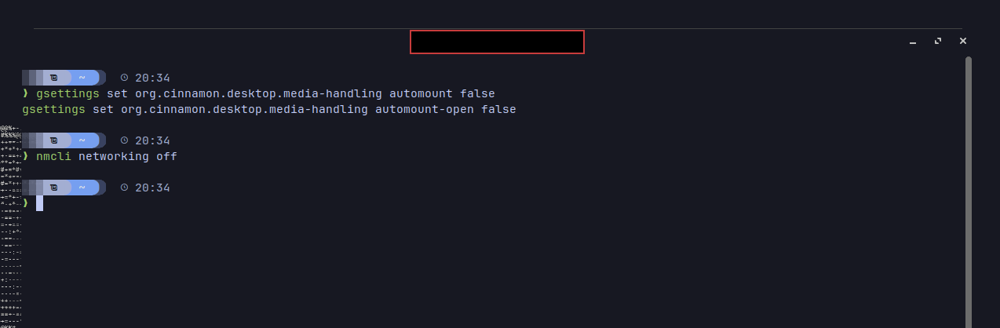

---

## 5. Fase 2 — Identificação do dispositivo

Com `sudo dmesg -wT` e `udevadm monitor --environment --udev` rodando lado a lado, o pendrive foi conectado **direto numa porta do notebook** (fora do hub), às 20:36:14.

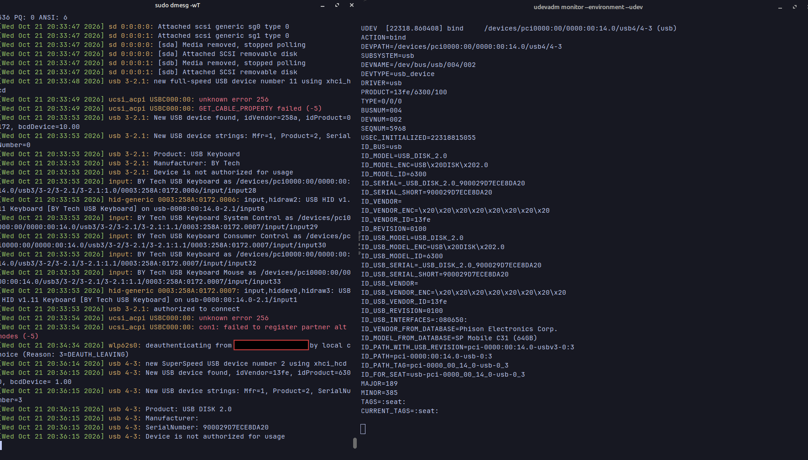

> As linhas das 20:33 são o teste de reconexão do hub (teclado reautorizado). Os erros `ucsi_acpi` vêm da controladora USB-C durante essa reconexão e não têm relação com o pendrive.

### 5.1 Evidências do kernel e do udev

```
usb 4-3: new SuperSpeed USB device number 2 using xhci_hcd
usb 4-3: New USB device found, idVendor=13fe, idProduct=6300, bcdDevice= 1.00
usb 4-3: Product: USB DISK 2.0
usb 4-3: Manufacturer:
usb 4-3: SerialNumber: 900029D7ECE8DA20
usb 4-3: Device is not authorized for usage
```

```
ID_USB_INTERFACES=:080650:
ID_VENDOR_FROM_DATABASE=Phison Electronics Corp.
ID_MODEL_FROM_DATABASE=SP Mobile C31 (64GB)
```

### 5.2 Confirmação no USBGuard

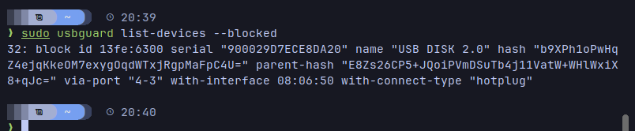

### 5.3 Análise

| Campo | Valor | Leitura |
|---|---|---|
| VID:PID | `13fe:6300` | Phison Electronics, fabricante legítima de controladoras |
| Velocidade | SuperSpeed (USB 3) | Apesar do nome "USB DISK 2.0" |
| Fabricante declarado | vazio (espaços) | ⚠️ Típico de pendrive genérico |
| Serial | `900029D7ECE8DA20` | Presente |
| **Interfaces** | **`08:06:50`** | ✅ **Uma única interface: Mass Storage / SCSI / Bulk-Only** |
| Modelo no banco de dados | SP Mobile C31 (64GB) | O ID `13fe:6300` é genérico e usado por vários modelos; o banco guarda só um nome. A capacidade real foi confirmada depois pelo `f3probe` |

> ✅ **Ponto de decisão:** nenhuma interface `03` (HID), `02`/`0a` (CDC) ou `ff` (Vendor). **Sem indício de BadUSB.** A análise pode prosseguir para o armazenamento.

---

## 6. Fase 3 — Aquisição forense

### 6.1 Autorização temporária e bloqueio de escrita

```bash
sudo usbguard allow-device 32          # sem -p: não é permanente
lsblk -o NAME,SIZE,TYPE,FSTYPE,LABEL,MODEL
```

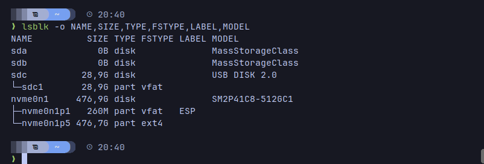

`sda` e `sdb` são os slots do leitor de cartão do hub. O pendrive é o **`sdc`**.

```bash
sudo blockdev --setro /dev/sdc
sudo blockdev --setro /dev/sdc1
```

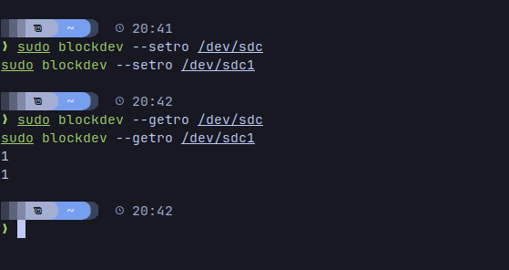

### 6.2 Layout de partições

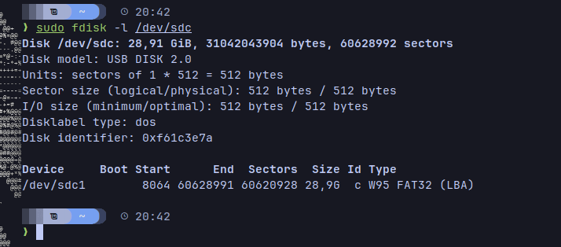

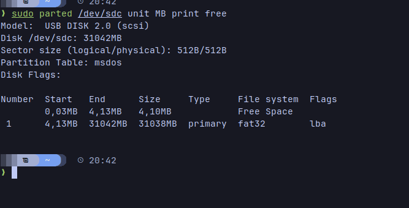

| Item | Leitura |
|---|---|
| Partição única até o último setor | ✅ Sem partições ocultas |
| Espaço não alocado | Só 4,10 MB no início (gap de alinhamento), padrão de fábrica para flash |

### 6.3 Imagem e cadeia de custódia

```bash
sudo dd if=/dev/sdc of=pendrive.img bs=4M status=progress conv=noerror,sync
```

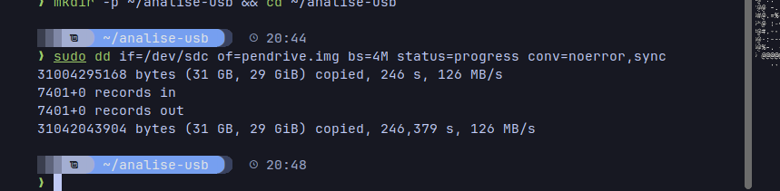

Todos os registros vieram completos (`7401+0`), sem nenhum erro de leitura. A velocidade de 126 MB/s confirma USB 3.

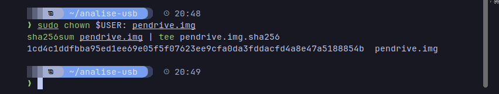

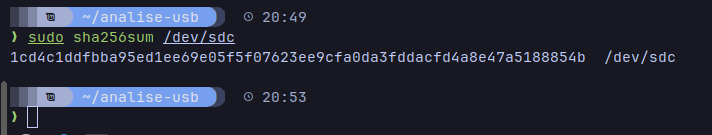

| Item | SHA-256 |
|---|---|
| `pendrive.img` | `1cd4c1ddfbba95ed1ee69e05f5f07623ee9cfa0da3fddacfd4a8e47a5188854b` |
| `/dev/sdc` | `1cd4c1ddfbba95ed1ee69e05f5f07623ee9cfa0da3fddacfd4a8e47a5188854b` |
| **Conferem?** | ✅ **Sim.** Daqui em diante toda a análise foi feita na imagem |

---

## 7. Fase 4 — Análise do conteúdo

### 7.1 Sistema de arquivos

Montagem segura da imagem (`ro,noexec,nosuid,nodev`):

```bash
sudo losetup -r -f -P --show pendrive.img      # → /dev/loop0
sudo mount -o ro,noexec,nosuid,nodev,uid=$(id -u),gid=$(id -g) /dev/loop0p1 /mnt/usb
```

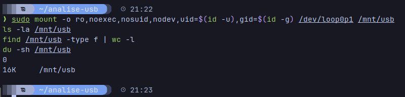

Metadados com o Sleuth Kit (`-o 8064` é o setor onde a partição começa):

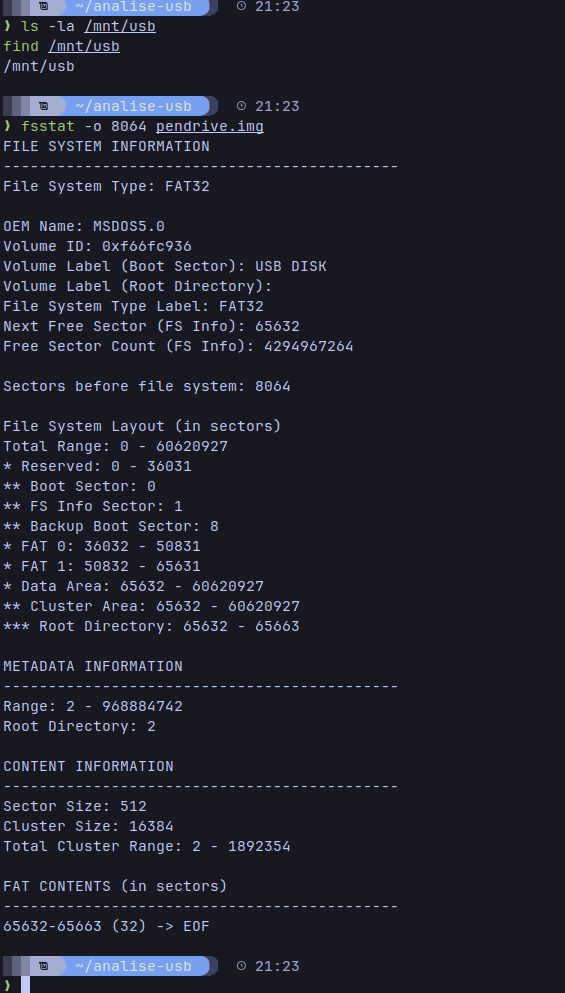

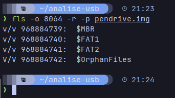

| Item | Valor | Leitura |
|---|---|---|
| OEM Name | `MSDOS5.0` | Assinatura de ferramenta de formatação Windows |
| Volume ID | `0xf66fc936` | |
| Label | `USB DISK` (só no boot sector) | Genérico de fábrica |
| Cluster | 16 KB, 1.892.353 clusters | Padrão para FAT32 de 32 GB |
| **Next Free Sector** | **65632** (primeiro setor de dados) | 🔑 Nada foi gravado desde a última formatação |
| Free Sector Count | `4294967264` (valor "desconhecido") | A ferramenta não calculou; o Windows nunca escreveu nele depois |
| **Tabela FAT** | Só `65632–65663 -> EOF` | 🔑 O único cluster alocado é o diretório raiz |
| **`fls`** | Só entradas virtuais (`$MBR`, `$FAT1`, `$FAT2`, `$OrphanFiles`) | 🔑 **Nenhum arquivo, nem apagado** |

> ✅ **Sem arquivos, sem `autorun.inf`, sem `.lnk`, sem executáveis.**

### 7.2 Varredura de dados fora do sistema de arquivos

Um sistema de arquivos vazio não significa um disco vazio: a formatação rápida não apaga os dados. Por isso foram contados os bytes não-zero em cada região.

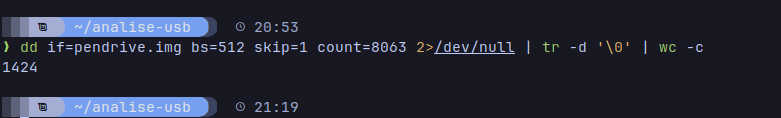

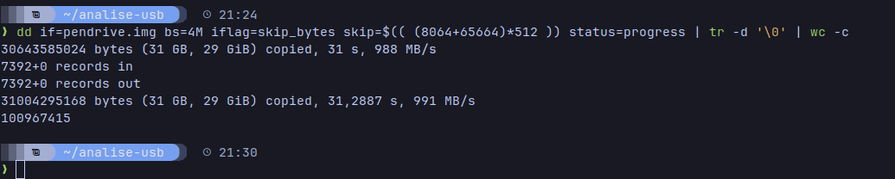

| Região | Bytes não-zero | Achado |
|---|---|---|
| Gap inicial (setores 1–8063) | 1.424 | Achado A |
| Área de dados (após o diretório raiz) | 100.967.415 (~96 MB) | Achados B e C |

Mapa da área de dados (script Python, blocos de 1 MB):

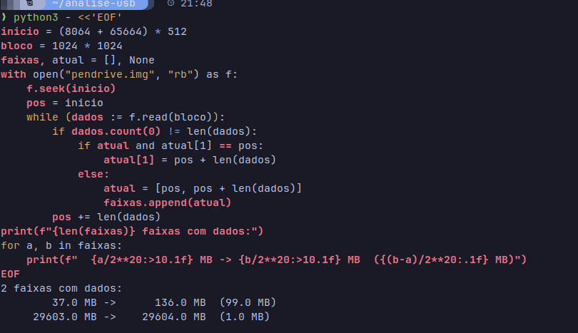

---

### Achado A — Gap inicial: artefato de fábrica

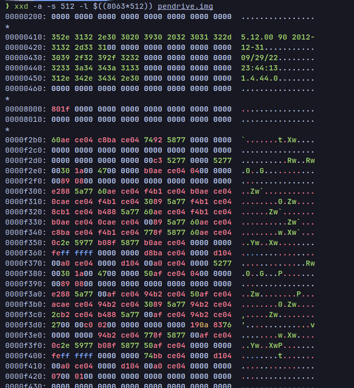

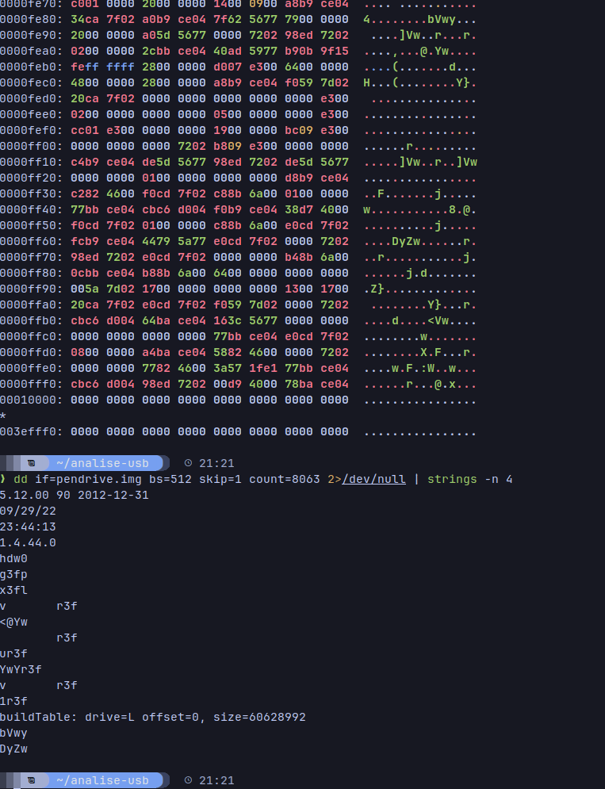

| Conteúdo | Offset | Interpretação |
|---|---|---|
| `5.12.00 90 2012-12-31`, `1.4.44.0` | `0x410`–`0x450` | Versões da ferramenta de produção (*MP Tool*) |
| `09/29/22` `23:44:13` | `0x430`–`0x440` | Data e hora da formatação de fábrica |
| `buildTable: drive=L offset=0, size=60628992` | — | 🔑 `size` = **exatamente** o número de setores do disco. A ferramenta, rodando no Windows com o pendrive em `L:`, construiu a tabela de partições |
| Bloco binário | `0xf2b0`–`0xffff` | Valores como `0x04ce....` e `0x775a....` (little-endian), na faixa de endereços de DLLs de processos Windows 32 bits. Lixo de memória (stack) da ferramenta |

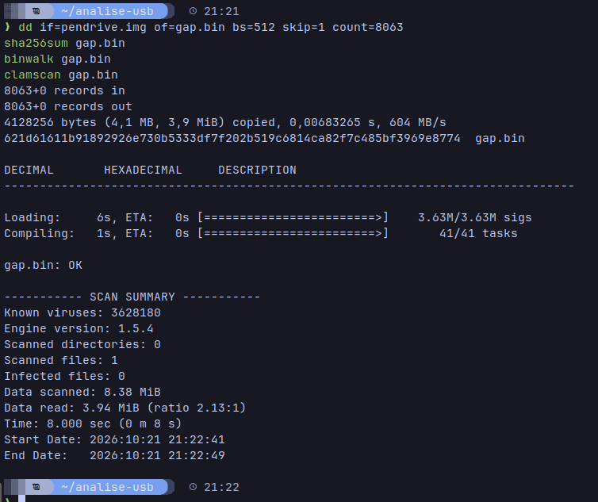

| Verificação | Resultado |
|---|---|
| SHA-256 `gap.bin` | `621d61611b91892926e730b5333df7f202b519c6814ca82f7c485bf3969e8774` |
| binwalk | Nenhuma assinatura |
| ClamAV | OK |
| **Classificação** | **Anomalia explicada: artefato de ferramenta de fábrica. Severidade baixa** |

---

### Achado B — Região de 99 MB: resíduo de uso anterior

A faixa começa logo após o diretório raiz, onde o FAT32 grava o primeiro arquivo. Esse é o padrão de **arquivos gravados por um usuário anterior seguidos de uma formatação rápida**, que criou um diretório raiz novo e zerado (por isso o `fls` não encontra entradas apagadas).

**binwalk na imagem:**

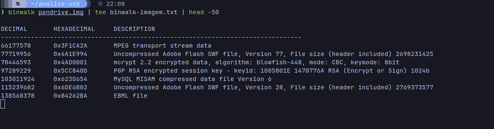

| Offset | Assinatura | Avaliação |
|---|---|---|
| `0x3F1CA2A` | MPEG transport stream | ❌ Falso positivo (ver o teste de sincronia abaixo) |
| `0x4A1E994` / `0x6DE6B02` | Adobe Flash SWF, tamanho ~2,6 GB | ❌ Falso positivo: tamanho impossível dentro de 99 MB |
| `0x4AD0001` | mcrypt 2.2 | ❌ Magic bytes curtos em dado de alta entropia |
| `0x5CC840D` | PGP RSA session key | ❌ Idem |
| `0x623D654` | MySQL MISAM | ❌ Idem |
| `0x84262BA` | EBML | ❌ Idem |

**Carving (PhotoRec 7.1):** 0 arquivos recuperados, ou seja, nenhum cabeçalho de arquivo reconhecível.

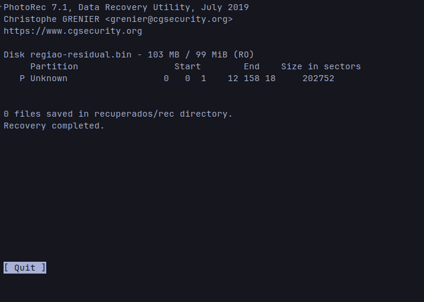

**Análise estatística (Python):**

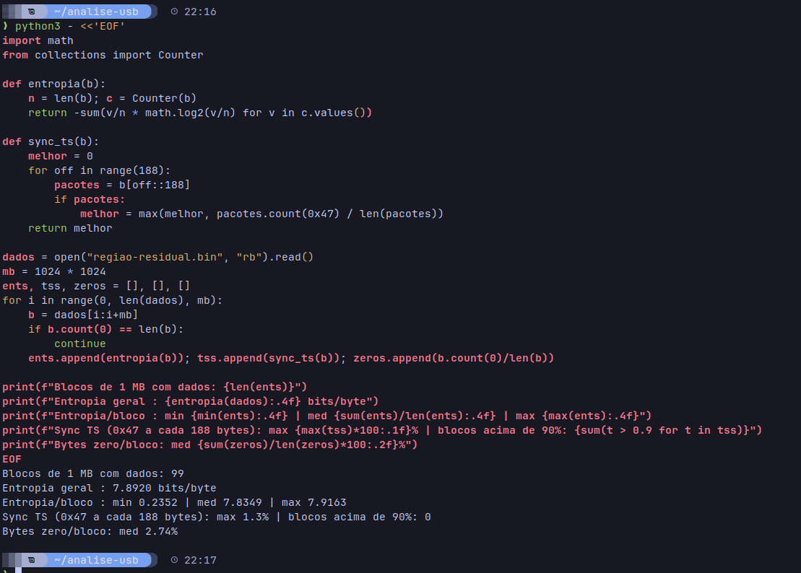

| Métrica | Valor | Referência | Leitura |
|---|---|---|---|
| Entropia geral | 7,8920 bits/byte | Criptografia ≈ 7,9998 | Abaixo de dado criptografado |
| Entropia por bloco de 1 MB | mín 0,2352 · med 7,8349 · máx 7,9163 | Criptografia: constante | Variável |
| Bytes zero | 2,74% | Aleatório = 0,39% (1/256) | ~7 vezes mais zeros que dado aleatório |
| Sincronia MPEG-TS (`0x47` a cada 188 bytes) | máx 1,3%, 0 blocos > 90% | Vídeo TS ≈ 100% | **Não é vídeo TS** |

**Início da região** (`xxd -a`): os dados começam em `0xfc000` com alguns inteiros (`00c0 1f00 ...`) e logo passam a alta entropia. Não há cabeçalho de formato conhecido (`MZ`, `ELF`, `PK`, `%PDF`).

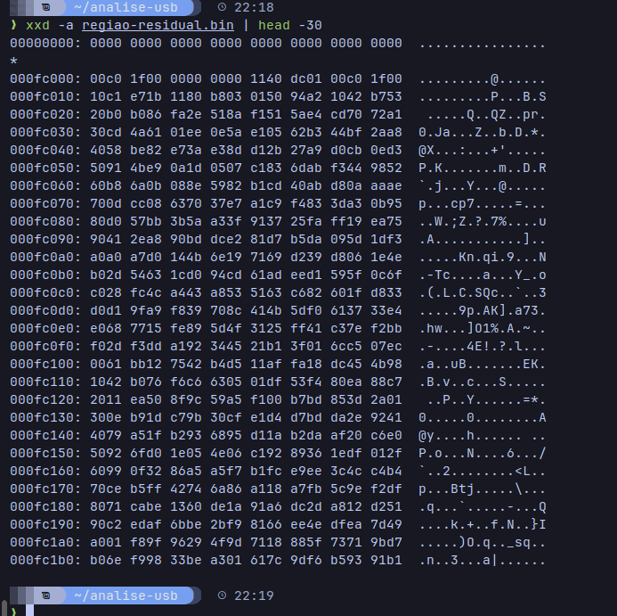

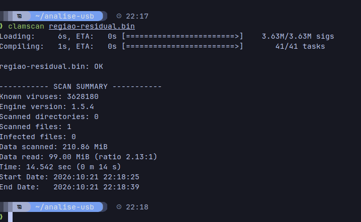

| Verificação | Resultado |
|---|---|
| ClamAV (99 MB) | OK, 0 infectados |
| **Classificação** | **Fragmentos de dados compactados ou mídia de um usuário anterior, sem cabeçalhos. Não criptografado, não executável. Severidade baixa** |

> 🔒 Os fragmentos são, muito provavelmente, dados pessoais de terceiros. Por isso a análise ficou restrita a estatística, assinaturas e antivírus: nenhum conteúdo foi aberto ou recuperado para leitura.

---

### Achado C — Setor no fim do disco

A hipótese inicial era um **cabeçalho GPT de backup** (que fica no último setor), o que indicaria um layout de partições anterior. O último setor estava zerado, então a **hipótese foi descartada**.

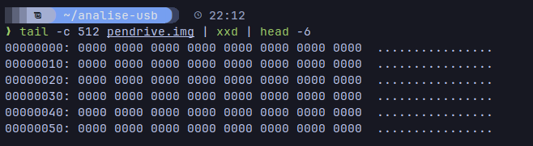

Os dados reais estão no **setor 60628976** (8 KB antes do fim, dentro do último cluster da partição): cerca de 250 bytes com padrões repetitivos (`0404`, `a141`, `4141`), primeiro byte `f8`, sem texto legível e sem assinatura conhecida.

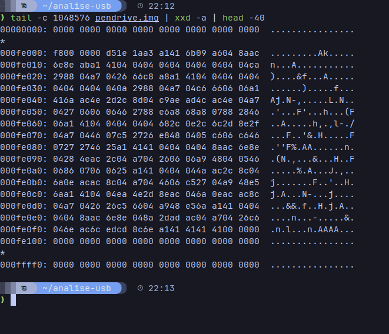

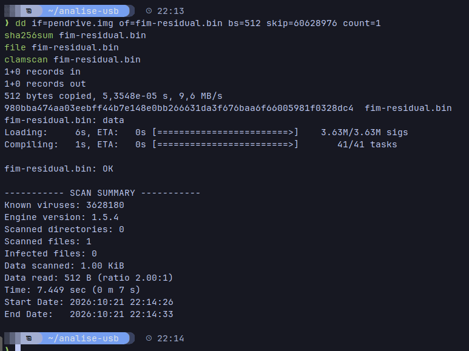

| Verificação | Resultado |
|---|---|
| SHA-256 `fim-residual.bin` | `980bba474aa03eebff44b7e148e0bb266631da3f676baa6f66005981f0328dc4` |
| `file` | `data` |
| ClamAV | OK |
| **Classificação** | **Resíduo não identificado, 256 bytes, sem assinatura, baixa entropia. Severidade baixa** |

---

## 8. Teste de capacidade real

```bash
sudo blockdev --setrw /dev/sdc
sudo blockdev --setrw /dev/sdc1
sudo f3probe --destructive --time-ops /dev/sdc
```

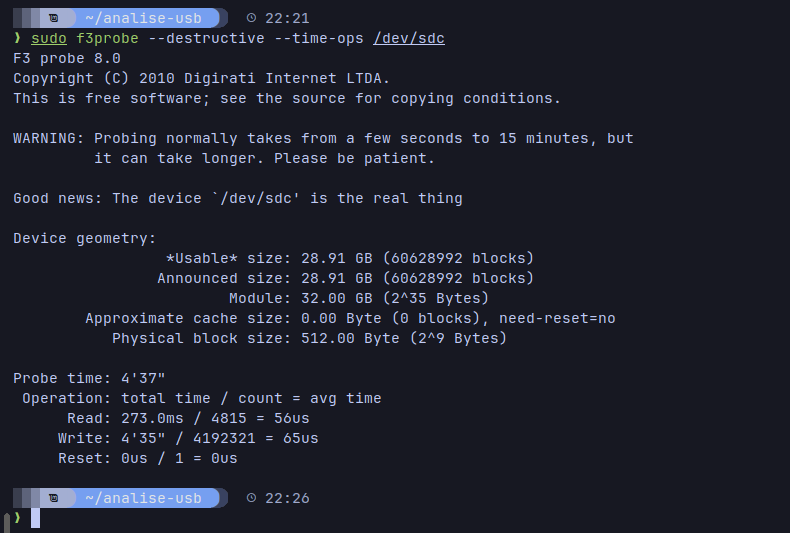

> ✅ **Capacidade real = capacidade anunciada.** Pendrive de 32 GB legítimo. O "64GB" do banco de dados de IDs era só o nome genérico associado ao `13fe:6300`.

---

## 9. Conclusão e veredito

| Verificação | Resultado |
|---|---|
| Só declara interface Mass Storage (`08`)? | ✅ Sim (`08:06:50`) |
| VID/PID coerente com fabricante? | ✅ Sim (Phison) |
| Sem partições ocultas? | ✅ Sim |
| Sem `autorun.inf` / `.lnk` / extensão dupla? | ✅ Sim (sistema de arquivos vazio) |
| Sem arquivos apagados recuperáveis pelo sistema de arquivos? | ✅ Sim |
| ClamAV sem detecções? | ✅ Sim (gap, região de 99 MB e setor final) |
| Resíduos explicados ou classificados? | ✅ Sim (A: fábrica · B: uso anterior · C: não identificado, inofensivo) |
| Capacidade real? | ✅ Sim |

### Veredito: ✅ LIMPO

Pendrive genérico com controladora Phison, formatado de fábrica em 29/09/2022, **usado por outra pessoa e depois submetido a formatação rápida**. Não há indício de BadUSB, malware, partição oculta ou capacidade falsa. Pode ser reutilizado após a sanitização.

---

## 10. Sanitização e restauração do ambiente

```bash
# Zerar o disco inteiro (apaga também os dados residuais do dono anterior)
sudo dd if=/dev/zero of=/dev/sdc bs=4M status=progress

# Recriar a partição e formatar
sudo parted /dev/sdc mklabel msdos
sudo parted -a optimal /dev/sdc mkpart primary fat32 0% 100%
sudo mkfs.vfat -F 32 -n PENDRIVE /dev/sdc1

# Restaurar o ambiente
nmcli networking on
gsettings set org.cinnamon.desktop.media-handling automount true
gsettings set org.cinnamon.desktop.media-handling automount-open true
```

> ⚠️ A sanitização limpa o **armazenamento**, não o **firmware**. Neste caso não há problema, porque a Fase 2 descartou BadUSB.

- **USBGuard mantido ativo** como hardening permanente.
- **Privacidade:** `pendrive.img` e `regiao-residual.bin` contêm fragmentos de dados de terceiros. Depois de documentada a análise, ficam guardados só os hashes e os artefatos pequenos (`gap.bin`, `fim-residual.bin`), e as imagens grandes são apagadas.

---

## 11. Lições aprendidas

1. **O USBGuard é a defesa que importa contra BadUSB.** O dispositivo entrou bloqueado e foi possível inspecionar as interfaces antes de qualquer interação. Antivírus não vê esse tipo de ataque.
2. **"Vazio" não é "limpo".** O sistema de arquivos não tinha nada, mas o disco tinha cerca de 96 MB de dados do dono anterior. A formatação rápida só recria a tabela.
3. **binwalk dá falso positivo em dados de alta entropia.** Assinaturas curtas aparecem por acaso; tamanhos impossíveis (SWF de 2,6 GB em 99 MB) denunciam o erro.
4. **Testes estatísticos separam hipóteses.** Entropia, proporção de zeros e periodicidade (sincronia TS) distinguiram "criptografado", "vídeo" e "compactado" sem abrir nenhum dado pessoal.
5. **Hipóteses descartadas também são resultado.** A suspeita de GPT de backup foi testada e registrada como falsa.
6. **Nunca analisar o original.** Bloqueio de escrita, imagem e hash: toda a análise da Fase 4 foi feita numa cópia verificada.
7. **Prints também vazam dados.** Hostname na barra de título, MAC do roteador no `dmesg`, hashes da allowlist e até texto de janelas ao fundo de um terminal transparente precisaram ser tratados antes da publicação.

---

## 12. Mitigações (ambiente corporativo)

| Mitigação MITRE | Aplicação |
|---|---|
| [M1034](https://attack.mitre.org/mitigations/M1034/) Limit Hardware Installation | USBGuard (Linux), GPO de controle de dispositivos (Windows/AD) |
| [M1042](https://attack.mitre.org/mitigations/M1042/) Disable or Remove Feature | Desativar autorun/autoplay e automount |
| [M1040](https://attack.mitre.org/mitigations/M1040/) Behavior Prevention on Endpoint | EDR detectando digitação sobre-humana e processos iniciados por dispositivo novo |
| [M1017](https://attack.mitre.org/mitigations/M1017/) User Training | Conscientização sobre o USB drop attack |

---

## 13. Linha do tempo

| Hora | Evento |
|---|---|
| 20:24 | Falha do espelho apt (HTTP 530), corrigida para `archive.ubuntu.com` |
| 20:27 | Bancos do ClamAV atualizados |
| 20:30 | Política do USBGuard gerada e ativada |
| 20:34 | Automount desativado, rede desligada |
| 20:36 | Pendrive conectado e **bloqueado** pelo USBGuard |
| 20:39 | Interfaces confirmadas: `08:06:50` (sem HID) |
| 20:40 | Autorização temporária, `lsblk` |
| 20:42 | Bloqueio de escrita, mapeamento de partições |
| 20:44–20:48 | Aquisição da imagem (`dd`, 126 MB/s) |
| 20:49–20:53 | Hashes conferidos |
| 21:19 | Achado A (gap inicial) |
| 21:23 | `fsstat` / `fls`: sistema de arquivos vazio |
| 21:30 | ~96 MB de dados residuais detectados |
| 21:48 | Mapa da área de dados |
| 22:08 | binwalk na imagem |
| 22:12–22:14 | Achado C (GPT descartado, setor final) |
| 22:16 | PhotoRec: 0 arquivos |
| 22:17 | Análise estatística da região de 99 MB |
| 22:18 | ClamAV na região: OK |
| 22:21–22:26 | `f3probe`: capacidade real |

---

## 14. Referências

- [MITRE ATT&CK — T1200 Hardware Additions](https://attack.mitre.org/techniques/T1200/)
- [MITRE ATT&CK — T1091 Replication Through Removable Media](https://attack.mitre.org/techniques/T1091/)
- [USBGuard — documentação](https://usbguard.github.io/)
- [The Sleuth Kit](https://www.sleuthkit.org/)
- [PhotoRec — CGSecurity](https://www.cgsecurity.org/wiki/PhotoRec)
- [f3 — Fight Flash Fraud](https://github.com/AltraMayor/f3)
- [ClamAV — documentação](https://docs.clamav.net/)
- [Lista de IDs USB (linux-usb.org)](http://www.linux-usb.org/usb.ids)
- Karsten Nohl & Jakob Lell — *BadUSB: On Accessories That Turn Evil* (Black Hat USA 2014)
